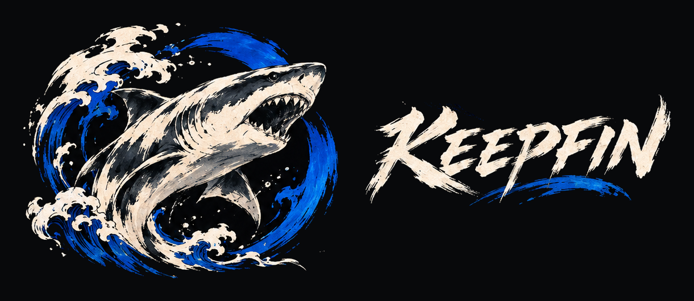
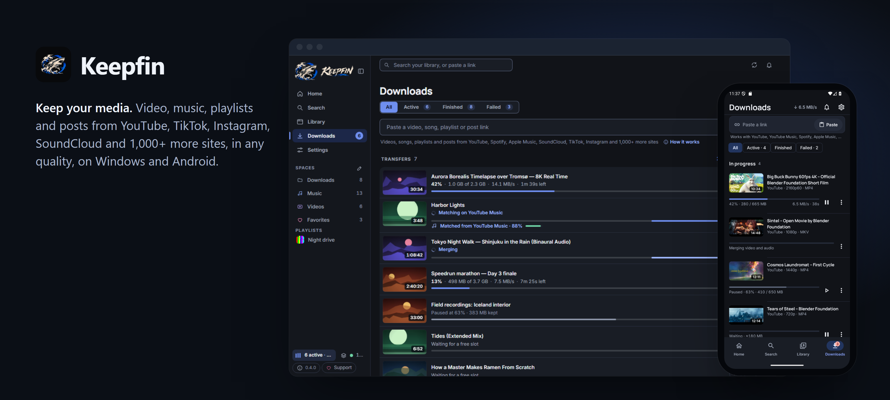
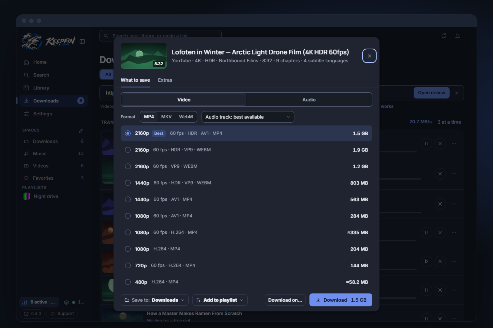
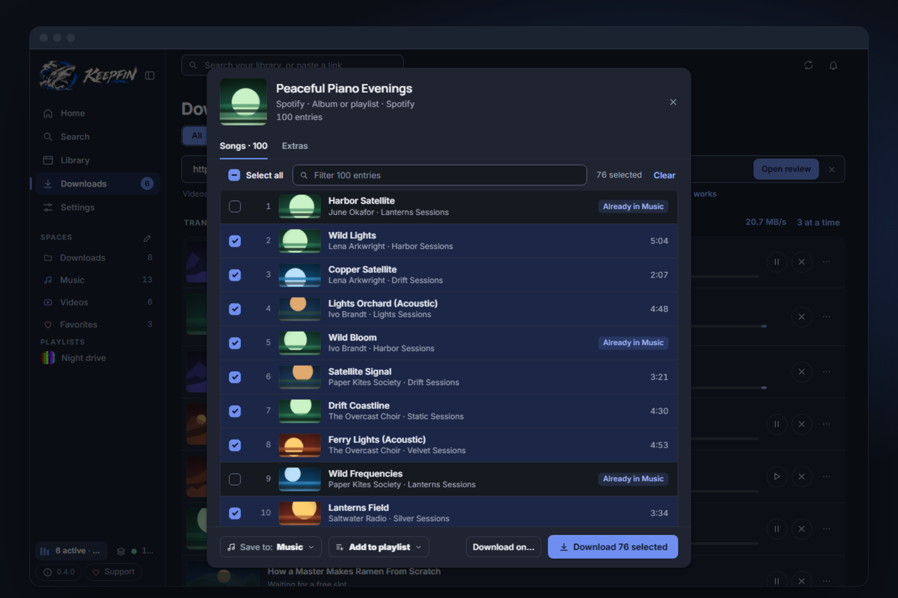
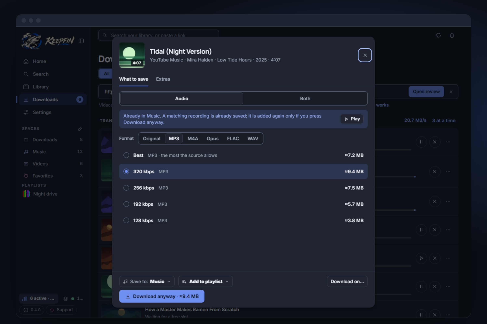
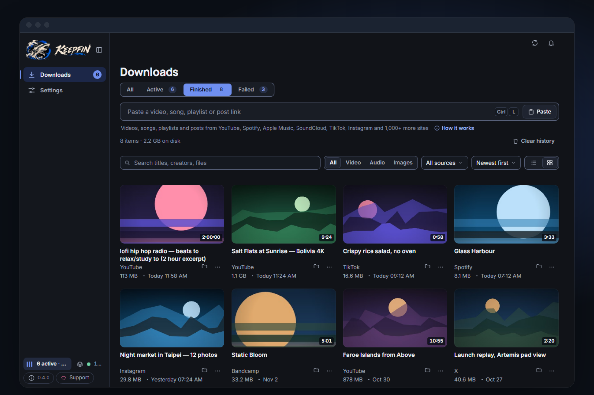
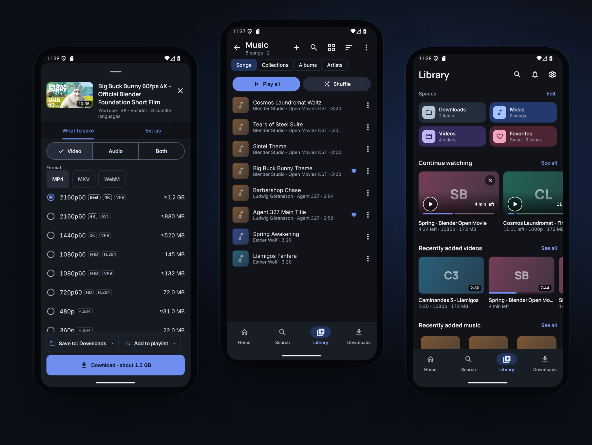
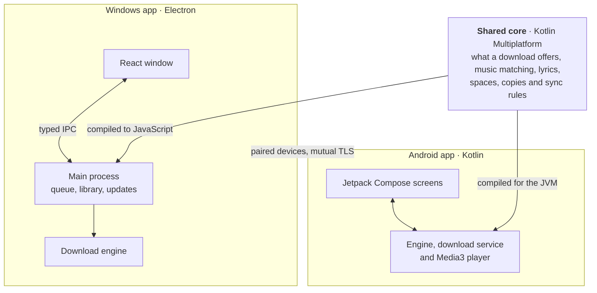

<div align="center">



# Keepfin

**Keep your media.** Download video, music, playlists, channels and posts from YouTube, YouTube Music, TikTok, Instagram, SoundCloud and more than 1,000 other sites, in every quality they offer, and keep them in one library you own.

For Windows and Android. Free, open source, no account.

[**Download**](https://github.com/HishamSanjag/keepfin/releases/latest) · [Website](https://keepfin.hishamsanjag.com) · [User guide](docs/README.md) · [Contributing](CONTRIBUTING.md)

<br>

<picture>
  <source media="(prefers-color-scheme: light)" srcset="docs/readme/banner-light.png">
  
</picture>

</div>

## Contents

- [Download](#download)
- [What it does](#what-it-does)
- [User guide](#user-guide)
- [How it works](#how-it-works)
- [Tech stack](#tech-stack)
- [Project structure](#project-structure)
- [For developers](#for-developers)
- [Tests and checks](#tests-and-checks)
- [Contributing](#contributing)
- [License](#license)

## Download

|             |                                                                                                                                                                                                         |
| ----------- | ------------------------------------------------------------------------------------------------------------------------------------------------------------------------------------------------------- |
| **Windows** | [Keepfin Setup](https://github.com/HishamSanjag/keepfin/releases/latest) installs in a few clicks and updates itself quietly. Also available: a Portable EXE, and an MSI for managed installs. |
| **Android** | [Keepfin APK](https://github.com/HishamSanjag/keepfin/releases/latest), Android 8 or later. It updates from inside the app.                                                                    |

Everything runs on your device. There is no Keepfin server, account or tracking.

New here? [Getting started](docs/getting-started.md) takes a few minutes.

## What it does

### Download

|                                           |                                                                                                                                                                  |
| ----------------------------------------- | ---------------------------------------------------------------------------------------------------------------------------------------------------------------- |
| **Paste a link, see every option**        | One preview shows Video, Audio or Both, every quality with its real size, and the format beside it. Extras (subtitles, cutting, chapters) wait on their own tab. |
| **Every quality**                         | 4K and 8K, HDR, 60 fps and every codec a site offers, saved as MP4, MKV or WebM.                                                                                 |
| **Music, properly tagged**                | MP3 (320 kbps by default), M4A, Opus, FLAC or WAV, with cover art, tags and timed lyrics.                                                                        |
| **Spotify, Apple Music and Deezer links** | Matched to the same recording on YouTube Music. Keepfin never takes audio from those services.                                                                   |
| **Songs and their videos**                | YouTube Music links are songs and YouTube links are videos. Keep both, and they stay on the same second when you switch.                                         |
| **Playlists and channels**                | Load page by page, pick what you want, download in parallel, and keep them in sync.                                                                              |
| **Private content**                       | Use your own sign-in for members-only and age-restricted media. It never leaves your device.                                                                     |

### Keep and play

|                           |                                                                                                                                               |
| ------------------------- | --------------------------------------------------------------------------------------------------------------------------------------------- |
| **A library and player**  | Spaces for music and videos, smart spaces, albums, artists, playlists, tags, search, Continue watching, lyrics and background playback.       |
| **One Keepfin folder**    | Everything lives in one folder you choose, as normal files that open in any app.                                                              |
| **Copies**                | A backup, mirror or two-way copy on another drive, a cloud account (Google Drive, Dropbox, WebDAV) or another device.                         |
| **Your devices together** | Pair your phone and PC once to play and copy each other's files on your network or away from home, and send a download from one to the other. |
| **Undo and Trash**        | Most changes can be undone, and deleted files wait in Trash for 30 days.                                                                      |
| **Looks after itself**    | The download engine updates itself daily, and the apps update from the releases feed.                                                         |

<table>
<tr>
<td width="50%"><picture><source media="(prefers-color-scheme: light)" srcset="docs/readme/formats-light.png"></picture></td>
<td width="50%"><picture><source media="(prefers-color-scheme: light)" srcset="docs/readme/collections-light.png"></picture></td>
</tr>
<tr>
<td width="50%"><picture><source media="(prefers-color-scheme: light)" srcset="docs/readme/audio-light.png"></picture></td>
<td width="50%"><picture><source media="(prefers-color-scheme: light)" srcset="docs/readme/library-light.png"></picture></td>
</tr>
</table>

<p align="center">
<picture>
  <source media="(prefers-color-scheme: light)" srcset="docs/readme/android-light.png">
  
</picture>
</p>

## User guide

| Page                                                             | What's in it                                                |
| ---------------------------------------------------------------- | ----------------------------------------------------------- |
| [Getting started](docs/getting-started.md)                       | Install, first start, your first download                   |
| [Downloading](docs/downloading.md)                               | Quality and formats, playlists, music links, private videos |
| [Library and player](docs/library-and-player.md)                 | Spaces, collections, tags, favorites, the players           |
| [Your folder, copies and devices](docs/folder-copies-devices.md) | The Keepfin folder, backups, cloud copies, pairing devices  |
| [Questions and answers](docs/faq.md)                             | Privacy, updates, and what to do when something goes wrong  |
| [What's new](docs/release-notes/)                                | What changed in each version                                |

## How it works

Keepfin is two native apps that share one core. Downloads run on your own device; there is nothing hosted.



A download goes through four steps on both apps:

1. **Read:** find out what the link is (a video, a song, a playlist, a channel, a photo post).
2. **Choose:** you pick the quality or format; sizes are shown before anything downloads.
3. **Download:** several at once, with automatic retries that continue where they stopped.
4. **Save:** the file gets its title, artist, cover and details, and goes into your Keepfin folder.

Decisions both apps must make the same way are written once in `core/`, and shared test cases in `fixtures/` run on both apps to prove it.

## Tech stack

|                     | Built with                                                                                    |
| ------------------- | --------------------------------------------------------------------------------------------- |
| **Windows**         | Electron, React, TypeScript, Vite, electron-builder and electron-updater                      |
| **Android**         | Kotlin, Jetpack Compose with Material 3, Media3, WorkManager, Coil                            |
| **Shared core**     | Kotlin Multiplatform, compiled to JVM and JavaScript                                          |
| **Download engine** | yt-dlp, gallery-dl and ffmpeg on Windows; youtubedl-android with ffmpeg and aria2c on Android |
| **Tests and CI**    | Node's test runner, Playwright, JUnit, Compose UI tests, GitHub Actions                       |

What each technology does here, with versions and links to its docs: **[Tech stack](docs/tech-stack.md)**.

## Project structure

```
android/    Android app (Kotlin, Jetpack Compose)
gui/        Windows app
  desktop/    Electron main process: engine, queue, library, updates
  web/        React window
  shared/     The typed contract and pure logic both sides use
core/       Shared core (Kotlin Multiplatform)
fixtures/   Shared test cases both apps must pass
assets/     Logo, icon and installer sources
content/    In-app guide text both apps show
scripts/    Build, check, test and release scripts
docs/       User guide, release notes and screenshots
```

The full map, and the rules that keep these parts apart: **[Project structure](docs/project-structure.md)**.

## For developers

Keepfin is built from one repository. These steps take you from nothing to both apps running on your machine.

### 1. Install the tools

| Tool                                                   | Version                            | Needed for                      |
| ------------------------------------------------------ | ---------------------------------- | ------------------------------- |
| [Git](https://git-scm.com/downloads)                   | any recent                         | Getting the code                |
| [Node.js](https://nodejs.org/)                         | 24 or later                        | The Windows app and all scripts |
| [JDK](https://adoptium.net/)                           | 17 or later                        | The shared core, on both apps   |
| [Android Studio](https://developer.android.com/studio) | with SDK 36 and build-tools 36.0.0 | The Android app only            |

### 2. Get the code

```powershell
git clone https://github.com/HishamSanjag/keepfin.git
cd keepfin
npm ci
```

`npm ci` installs the dependencies and turns on the pre-commit checks.

### 3. Run the Windows app

```powershell
npm start
```

This builds the shared core and the app, then opens it. The download engine fetches itself the first time you download something.

For quick interface work, `npm run dev` opens the window in a browser. It has no download engine, so nothing really downloads there.

### 4. Run the Android app

Connect a phone with USB debugging on, or start an emulator, then:

```powershell
npm run android:build -- --debug
adb install -r releases/<version>/Keepfin-Android-<version>.apk
```

The script finds the Android SDK through `ANDROID_HOME`, or its default place on Windows. You can also open the `android/` folder in Android Studio and press Run.

A debug build feels noticeably slower than the real app. To judge speed, leave out `-- --debug`: that gives the optimized APK.

### 5. Build the installers

| Command                                          | What you get                                          |
| ------------------------------------------------ | ----------------------------------------------------- |
| `npm run desktop:build -- --win --publish never` | Windows Setup, Portable and MSI in `releases/desktop` |
| `npm run android:build`                          | The optimized Android APK in `releases/<version>`     |

### Useful commands

| Command                 | What it does                                                    |
| ----------------------- | --------------------------------------------------------------- |
| `npm run icons:build`   | Regenerates every app icon and the installer art from `assets/` |
| `npm run readme:images` | Rebuilds the README pictures from `docs/screenshots/`           |

`package.json` lists every other command.

### If something goes wrong

- **The Windows app won't open from a terminal:** if your shell sets `ELECTRON_RUN_AS_NODE=1`, unset it first.
- **Gradle can't find the SDK:** set `ANDROID_HOME` to your Android SDK folder.
- **A build fails on the shared core:** check that `java -version` shows 17 or later.

## Tests and checks

| Command                                      | What it proves                                                                                   |
| -------------------------------------------- | ------------------------------------------------------------------------------------------------ |
| `npm run check`                              | Layer rules, links, file sizes, TypeScript, unit tests and builds                                |
| `npm run gui:ui-test`                        | The Windows screens with a fake engine: flows, progress and layout                               |
| `npm run engine:test`                        | The real engine on a generated local video (`-- --live` adds YouTube, YouTube Music and Spotify) |
| `gradlew.bat :app:testDebugUnitTest`         | Android unit tests (run from `android/`)                                                         |
| `gradlew.bat :app:connectedDebugAndroidTest` | Android engine and UI tests on an emulator or device                                             |

## Contributing

Bug reports, ideas and pull requests are welcome: see [CONTRIBUTING.md](CONTRIBUTING.md). Please report security problems privately, as described in [SECURITY.md](SECURITY.md). The words used across the code are defined in [CONTEXT.md](CONTEXT.md).

## License

[MIT](LICENSE) © 2026 Hisham Sanjag. Bundled components keep their own licenses: see [THIRD-PARTY-NOTICES.md](THIRD-PARTY-NOTICES.md).

If Keepfin is useful to you, you can [support its development](https://github.com/sponsors/HishamSanjag).
