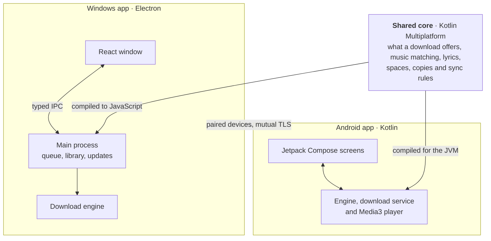

<div align="center">


# Keepfin

**Video and music downloader for Windows and Android.**

Save videos, songs and playlists from YouTube, YouTube Music, Facebook, Instagram, TikTok and more. Paste a link, choose video or audio, and download it to your device for offline use.

Free and open source. No Keepfin account required.

[**Download for Windows**](https://github.com/HishamSanjag/keepfin/releases/latest) · [**Download for Android**](https://github.com/HishamSanjag/keepfin/releases/latest) · [Website](https://keepfin.hishamsanjag.com) · [User guide](docs/README.md)

<br>

<picture>
  <source media="(prefers-color-scheme: light)" srcset="docs/readme/banner-light.png">
  
</picture>

</div>

[Download](#download) · [Supported sites](#supported-sites) · [Features](#features) · [User guide](#user-guide) · [For developers](#for-developers)

## Download

| Your device | What to download | Other options |
| --- | --- | --- |
| **Windows** | [Keepfin Setup](https://github.com/HishamSanjag/keepfin/releases/latest), with automatic app updates | Portable EXE to run without installing; MSI for managed installs |
| **Android 8+** | [Keepfin APK](https://github.com/HishamSanjag/keepfin/releases/latest), with updates available inside the app | Allow APK installation when your phone asks |

Both links open the latest release. Expand **Assets** to find the installer or APK for your device.

### Your first download

1. **Paste a link** from a supported site. On Android, you can also share a link directly to Keepfin.
2. **Choose video or audio**, then pick the quality or file format.
3. **Press Download.** Keep the file for offline use, play it in Keepfin, or open it in another app.

Choose **Just downloads** during setup for a simple downloader, or **Keepfin Complete** for the library and players too. See the [getting started guide](docs/getting-started.md) for installation and setup.

## Supported sites

YouTube · YouTube Music · Facebook · Instagram · TikTok · X · Reddit · Vimeo · Twitch · SoundCloud · Bandcamp · Pinterest · and many more.

Available media, quality and sign-in requirements depend on the site and the link. Site changes can temporarily affect downloads; see the [downloading guide](docs/downloading.md) for details.

**Spotify, Apple Music and Deezer links:** Keepfin reads the track, album or playlist details and finds matching recordings on YouTube Music. Audio comes from YouTube Music.

## Features

| What you want to do | What Keepfin offers |
| --- | --- |
| **Save a video** | Choose the available quality, up to 4K or 8K, including HDR and 60 fps when the source offers them. Save as MP4, MKV or WebM. |
| **Download only the audio** | Choose MP3, M4A, Opus, FLAC or WAV, with cover art, tags and lyrics when available. Converting to FLAC does not improve the source audio quality. |
| **Download a playlist or channel** | Review items as they load, select what you want, download several at once, and optionally check for new items later. |
| **Save photo posts on Windows** | Download images from supported posts on Instagram, Pinterest, Reddit and other sites. |
| **Choose extras** | Save subtitles, keep chapters or download part of a video. |
| **Access media that needs sign-in** | Use your own website sign-in for supported private, members-only or age-restricted content your account can access. |
| **Organize and play your files** | Use the built-in library, playlists, search and players, including lyrics and background playback. Files also open in other apps. |
| **Back up or move between devices** | Make copies on another drive or a cloud account, and pair your phone and PC to play, copy or send downloads between them. |

Downloads run on your device. There is no Keepfin server, account or tracking. Your media is saved as normal files in a folder you choose.

### Screenshots

<table>
<tr>
<td width="50%"><picture><source media="(prefers-color-scheme: light)" srcset="docs/readme/formats-light.png"></picture></td>
<td width="50%"><picture><source media="(prefers-color-scheme: light)" srcset="docs/readme/collections-light.png"></picture></td>
</tr>
<tr>
<td width="50%"><picture><source media="(prefers-color-scheme: light)" srcset="docs/readme/audio-light.png"></picture></td>
<td width="50%"><picture><source media="(prefers-color-scheme: light)" srcset="docs/readme/library-light.png"></picture></td>
</tr>
</table>

<p align="center">
<picture>
  <source media="(prefers-color-scheme: light)" srcset="docs/readme/android-light.png">
  
</picture>
</p>

## User guide

| Page                                                             | What's in it                                                |
| ---------------------------------------------------------------- | ----------------------------------------------------------- |
| [Getting started](docs/getting-started.md)                       | Install, first start, your first download                   |
| [Downloading](docs/downloading.md)                               | Quality and formats, playlists, music links, private videos |
| [Library and player](docs/library-and-player.md)                 | Spaces, collections, tags, favorites, the players           |
| [Your folder, copies and devices](docs/folder-copies-devices.md) | The Keepfin folder, backups, cloud copies, pairing devices  |
| [Questions and answers](docs/faq.md)                             | Privacy, updates, and what to do when something goes wrong  |
| [What's new](docs/release-notes/)                                | What changed in each version                                |

## How it works

Keepfin has a Windows app and a native Android app that share one core. Downloads run on your own device.



A download goes through four steps on both apps:

1. **Read:** find out what the link is (a video, a song, a playlist, a channel, a photo post).
2. **Choose:** you pick the quality or format; single videos and songs show file size estimates before downloading.
3. **Download:** several at once, with automatic retries that continue where they stopped.
4. **Save:** the file gets its title, artist, cover and details, and goes into your Keepfin folder.

Decisions both apps must make the same way are written once in `core/`, and shared test cases in `fixtures/` run on both apps to prove it.

## Tech stack

|                     | Built with                                                                                    |
| ------------------- | --------------------------------------------------------------------------------------------- |
| **Windows**         | Electron, React, TypeScript, Vite, electron-builder and electron-updater                      |
| **Android**         | Kotlin, Jetpack Compose with Material 3, Media3, WorkManager, Coil                            |
| **Shared core**     | Kotlin Multiplatform, compiled to JVM and JavaScript                                          |
| **Tests and CI**    | Node's test runner, Playwright, JUnit, Compose UI tests, GitHub Actions                       |

What each technology does here, with versions and links to its docs: **[Tech stack](docs/tech-stack.md)**.

## Project structure

```
android/    Android app (Kotlin, Jetpack Compose)
gui/        Windows app
  desktop/    Electron main process: engine, queue, library, updates
  web/        React window
  shared/     The typed contract and pure logic both sides use
core/       Shared core (Kotlin Multiplatform)
fixtures/   Shared test cases both apps must pass
assets/     Logo, icon and installer sources
content/    In-app guide text both apps show
scripts/    Build, check, test and release scripts
docs/       User guide, release notes and screenshots
```

The full map, and the rules that keep these parts apart: **[Project structure](docs/project-structure.md)**.

## For developers

Keepfin is built from one repository. These steps take you from nothing to both apps running on your machine.

### 1. Install the tools

| Tool                                                   | Version                            | Needed for                      |
| ------------------------------------------------------ | ---------------------------------- | ------------------------------- |
| [Git](https://git-scm.com/downloads)                   | any recent                         | Getting the code                |
| [Node.js](https://nodejs.org/)                         | 24 or later                        | The Windows app and all scripts |
| [JDK](https://adoptium.net/)                           | 17 or later                        | The shared core, on both apps   |
| [Android Studio](https://developer.android.com/studio) | with SDK 36 and build-tools 36.0.0 | The Android app only            |

### 2. Get the code

```powershell
git clone https://github.com/HishamSanjag/keepfin.git
cd keepfin
npm ci
```

`npm ci` installs the dependencies and turns on the pre-commit checks.

### 3. Run the Windows app

```powershell
npm start
```

This builds the shared core and the app, then opens it. The download engine fetches itself the first time you download something.

For quick interface work, `npm run dev` opens the window in a browser. It has no download engine, so nothing really downloads there.

### 4. Run the Android app

Connect a phone with USB debugging on, or start an emulator, then:

```powershell
npm run android:build -- --debug
adb install -r releases/<version>/Keepfin-Android-<version>.apk
```

The script finds the Android SDK through `ANDROID_HOME`, or its default place on Windows. You can also open the `android/` folder in Android Studio and press Run.

A debug build feels noticeably slower than the real app. To judge speed, leave out `-- --debug`: that gives the optimized APK.

### 5. Build the installers

| Command                                          | What you get                                          |
| ------------------------------------------------ | ----------------------------------------------------- |
| `npm run desktop:build -- --win --publish never` | Windows Setup, Portable and MSI in `releases/desktop` |
| `npm run android:build`                          | The optimized Android APK in `releases/<version>`     |

### Useful commands

| Command                 | What it does                                                    |
| ----------------------- | --------------------------------------------------------------- |
| `npm run icons:build`   | Regenerates every app icon and the installer art from `assets/` |
| `npm run readme:images` | Rebuilds the README pictures from `docs/screenshots/`           |

`package.json` lists every other command.

### If something goes wrong

- **The Windows app won't open from a terminal:** if your shell sets `ELECTRON_RUN_AS_NODE=1`, unset it first.
- **Gradle can't find the SDK:** set `ANDROID_HOME` to your Android SDK folder.
- **A build fails on the shared core:** check that `java -version` shows 17 or later.

## Tests and checks

| Command                                      | What it proves                                                                                   |
| -------------------------------------------- | ------------------------------------------------------------------------------------------------ |
| `npm run check`                              | Layer rules, links, file sizes, TypeScript, unit tests and builds                                |
| `npm run gui:ui-test`                        | The Windows screens with a fake engine: flows, progress and layout                               |
| `npm run engine:test`                        | The real engine on a generated local video (`-- --live` adds YouTube, YouTube Music and Spotify) |
| `gradlew.bat :app:testDebugUnitTest`         | Android unit tests (run from `android/`)                                                         |
| `gradlew.bat :app:connectedDebugAndroidTest` | Android engine and UI tests on an emulator or device                                             |

## Contributing

Bug reports, ideas and pull requests are welcome: see [CONTRIBUTING.md](CONTRIBUTING.md). Please report security problems privately, as described in [SECURITY.md](SECURITY.md). The words used across the code are defined in [CONTEXT.md](CONTEXT.md).

## License

[MIT](LICENSE) © 2026 Hisham Sanjag. Bundled components keep their own licenses: see [THIRD-PARTY-NOTICES.md](THIRD-PARTY-NOTICES.md).

If Keepfin is useful to you, you can [support its development](https://github.com/sponsors/HishamSanjag).
